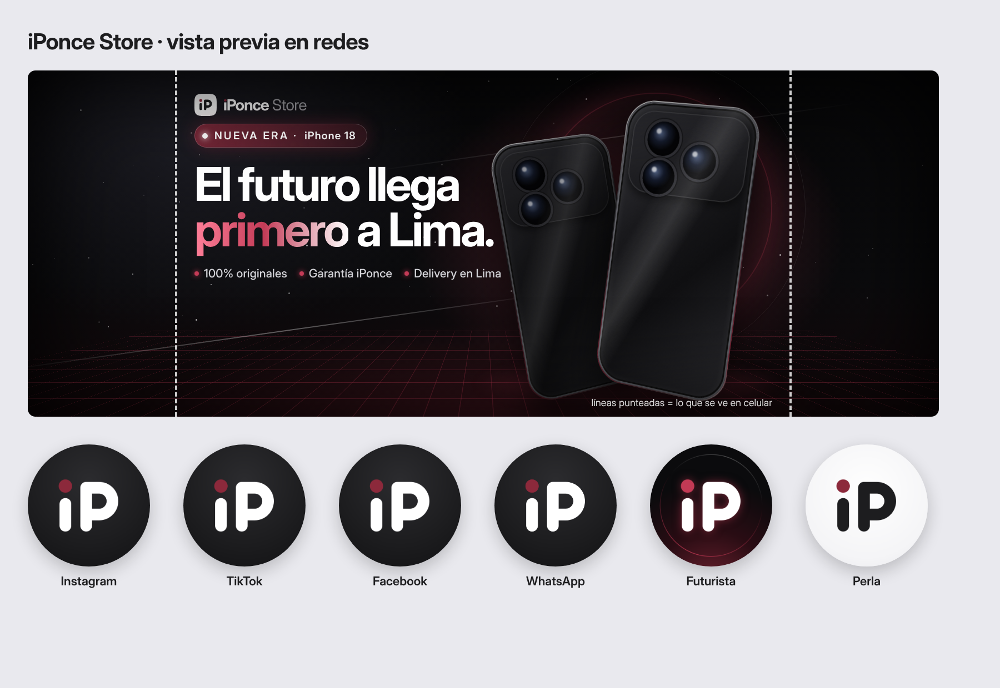

# iPonce Store · Kit de marca



## ¿Qué archivo subo a cada red?

| Red | Archivo | Nota |
|---|---|---|
| Instagram (perfil) | `perfil/instagram-perfil-1080x1080.png` | Instagram lo recorta en círculo; el logo ya está centrado para eso. |
| TikTok (perfil) | `perfil/tiktok-perfil-1080x1080.png` | Igual: recorte circular. |
| Facebook (perfil) | `perfil/facebook-perfil-2048x2048.png` | Alta resolución para que no se vea borroso. |
| Facebook (portada) | `portada/facebook-portada-1640x624.png` | Si Facebook la comprime mucho, prueba la versión `.jpg`. |
| WhatsApp (perfil) | `perfil/whatsapp-perfil-640x640.png` | WhatsApp usa 640 × 640; más grande no mejora. |

Hay dos fotos de perfil alternativas en `perfil/variantes/`: **futurista** (con brillo burgundy, combina con la portada) y **perla** (fondo claro). Usa la misma en todas las redes para que te reconozcan.

**La portada de Facebook en celular** solo muestra la parte central. Lo importante (texto y celulares) está dentro de la zona segura que marcan las líneas punteadas de la vista previa.

## Logos para todo lo demás

- `logo/vector/*.svg` y `*.pdf`: **vectoriales**, se pueden ampliar sin perder calidad. Son los que debes entregar a imprentas, a quien te haga stickers, letreros, bolsas o cajas, y a tu diseñador web.
- `logo/png/*.png`: con fondo transparente, para poner encima de tus fotos o diseños en Canva, CapCut, historias, etc.
  - `para-fondo-claro` = letras oscuras · `para-fondo-oscuro` = letras blancas.
  - Ojo: la versión `para-fondo-oscuro` **se ve "vacía" si la abres en un visor con fondo blanco**. No está dañada: el texto es blanco y el fondo transparente.
- `logo/png/con-fondo/*.png`: el logo con el fondo ya puesto (grafito o perla). Úsalos cuando no sepas qué elegir: se ven bien en cualquier lado.

## Colores

| Nombre | HEX |
|---|---|
| Grafito | `#1D1D1F` |
| Burgundy | `#8C293B` |
| Burgundy luz (efectos/brillos) | `#C23A55` |
| Perla | `#F5F5F7` |
| Gris texto | `#6E6E73` |

Tipografía: **Inter Display** (gratuita, licencia OFL). Está en `fuente/fonts/`.

## Regenerar los archivos

Todo sale de `fuente/generar.mjs`. Si cambias un texto o un color ahí, vuelve a generar con:

```
NODE_PATH=$(npm root -g) node marca/fuente/generar.mjs
```

(Requiere Node, Playwright con Chromium y `pdftocairo`.)
